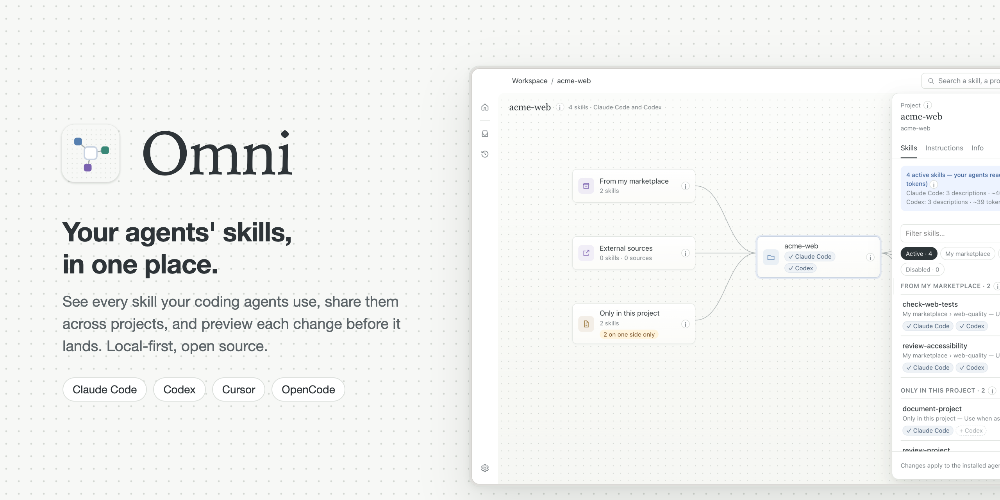
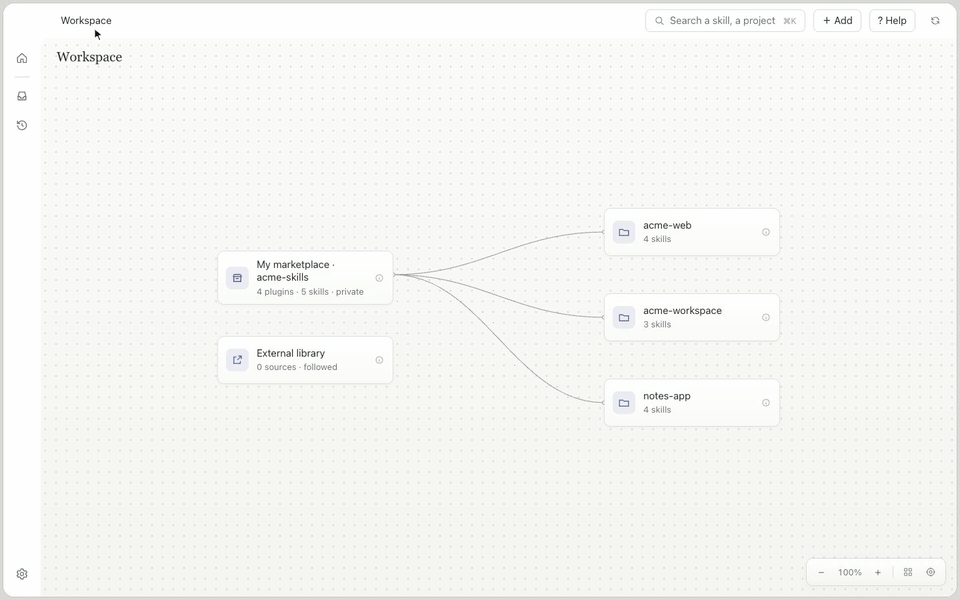

<p align="center">
  
</p>

# Omni

[](https://github.com/suarja/omni/releases/latest)
[](https://github.com/suarja/omni/actions/workflows/ci.yml)
[](LICENSE)


**Your coding agents' skills, in one place.** Omni is a local-first macOS app that shows every
skill, plugin and instruction file your agents read, across all your projects, and lets you add,
share and update them with a preview before anything changes.

It reads the conventions of Claude Code, Codex, Cursor and OpenCode, and connects to Claude Code
and Codex so they can ask Omni for the right skill instead of writing a new copy.

<p align="center">
  <a href="https://github.com/suarja/omni/releases/latest"><b>Download for macOS</b></a>
  &nbsp;·&nbsp;
  <a href="#how-it-works">How it works</a>
  &nbsp;·&nbsp;
  <a href="#use-omni-from-your-agents">Use it from your agents</a>
</p>

<p align="center">
  
</p>

## Why Omni

- **See what your agents really read.** Every project shows its skills, where each one comes from
  (your marketplace, an external source, or only this project), which agent has it, and what it
  costs at the start of every session.
- **Write a skill once, use it everywhere.** Keep reusable skills in your own Git marketplace and
  add them to any project, for Claude Code and Codex at the same time.
- **Nothing changes behind your back.** Every change is previewed first, recorded with a receipt,
  and can be undone. Omni never overwrites local edits and never runs plugin hooks on its own.
- **Local-first.** No account, no server, no telemetry. Your skills stay in your folders and your
  Git repositories.

## How it works

1. **Connect your marketplace.** A Git repository of plugins and skills, yours or an existing one.
2. **Add your projects.** Omni reads each folder and maps what is installed, duplicated, changed
   or missing, without touching it.
3. **Connect your agents.** One click installs the Omni tool and skills for Claude Code and Codex.
4. **Add, update, undo.** Pick skills for a project, review the preview, apply. Every change can be
   undone from its receipt.

## Install

Download the latest `Omni-<version>-arm64.dmg` from
[Releases](https://github.com/suarja/omni/releases/latest), open it and drag Omni to
Applications. Builds are signed with a Developer ID and notarized by Apple. Omni updates itself
from GitHub Releases; you can turn this off in Settings.

Requirements: macOS on Apple silicon.

## Use Omni from your agents

Omni ships a stdio MCP runtime that talks to the running app over a local, authenticated gateway.
The app owns state, previews, approvals and receipts; the runtime never writes marketplace or
project files directly.

Connect them from **Settings → Agents** in Omni: one click per agent, previewed like any other
change. To install the plugin by hand, see the [Omni plugin guide](plugins/omni/README.md); the
[MCP runtime guide](packages/omni-mcp/README.md) covers manual configuration and diagnostics.

## Build from source

Install Git, Node.js 24 or later, and pnpm 10.33.0, then:

```sh
pnpm install --frozen-lockfile
pnpm dev
```

Run the checks before contributing:

```sh
pnpm typecheck
pnpm lint
pnpm test --maxWorkers=4
```

[Releasing](docs/releasing.md) explains how signed releases are built.

## Documentation

- [Product and documentation index](docs/README.md)
- [Architecture](docs/architecture/README.md)
- [Harness conventions](docs/conventions/README.md)
- [Contributing](CONTRIBUTING.md)
- [Security reporting](SECURITY.md)

## License

Omni is available under the [MIT license](LICENSE).
